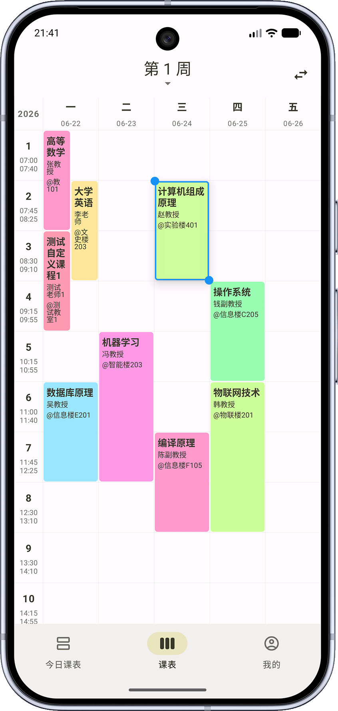
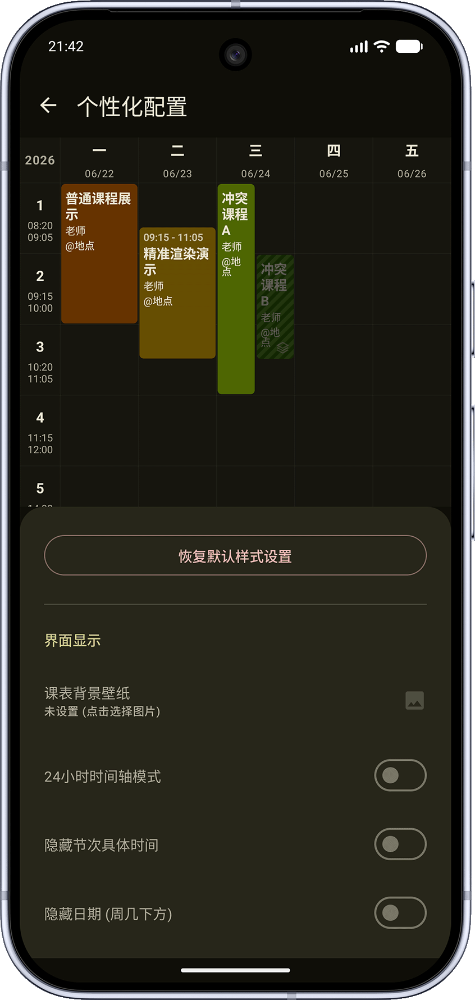
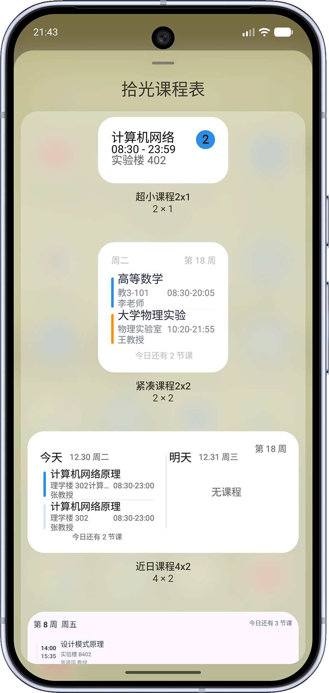

<div align="center">

# 财院课程表

湖南财政经济学院（HUFE）定制版课程表


本项目基于开源项目 [拾光课程表（XingHeYuZhuan/shiguangschedule）](https://github.com/XingHeYuZhuan/shiguangschedule)
的 **v2.1.0** 源码快照修改，按 Apache-2.0 许可发布，保留上游版权声明。

</div>

> [!IMPORTANT]
> **本项目只为湖南财政经济学院（HUFE）定制，不适配其他学校。**
> 内置的作息、错峰规则、开学日期与教务适配都是湖财专有的；其他学校的同学请使用上游
> [拾光课程表](https://github.com/XingHeYuZhuan/shiguangschedule)，或基于上游自行适配。

---

## 这是什么

把通用的课表工具改成「湖财同学开箱即用」的版本：内置湖财作息与错峰规则、默认 9 月 5 日开学、
预置湖财教务适配，并把主界面的切换做成手机原生的跟手横滑。
课表的导入、导出、小组件、提醒等能力沿用上游完整实现。

## 与上游 v2.1.0 的差异

### 界面与交互

- **一级页面横滑切换**：今日课表 / 课表 / 我的 放进同一个横向分页容器，手指拖动跟手、松手按位移与速度吸附，
  点底部导航则是滚动到目标页，两种操作共用同一套动画。
- **切换方向跟随页面位置**：切到右侧的页面就从右侧滑入、切到左侧的页面从左侧滑入。
  修复了原来不管往哪个方向切，动画都朝同一方向的问题。
- **周课表默认显示周末**：湖财有周末课程，周课表默认就带上周六、周日两列；不需要时可在
  「我的 → 通用设置 → 是否显示周末」关闭。
- **课表页顶部新增「导入」入口**：直接进「课表导入/导出」，不用再去「我的 → 高级设置」里翻。
- **周次切换改为标题栏**：课表页左右横滑以前是翻周，现在留给一级页面切换；切周用顶部标题里的周次选择器
  （会标记当前日期所在周）。
- 切换页面时会重置导航栏的折叠状态，不会把某一页滚动后的隐藏状态带到别的页面。

### 课表数据

- **内置默认作息**：换成《湖南财政经济学院主校区上课作息时间》的 12 节（`DefaultSchedule`），
  新建课表与首次启动都用这套时间。
- **默认开学日期 9 月 5 日**（`DefaultSemester`）：新安装 / 新建课表时自动填入「最近一次 9 月 5 日」
  （8 月及以后取今年，1—7 月取去年），不用再先去设置页手动设置一遍。
- **第 3、4 节错峰规则**（`StaggeredSchedule`）：判定依据是学校《主校区上课作息时间》（附件 3），
  按「**当前节次 × 上课教室**」查表 —— 第 3 节 2 种上课时间（一/二教、实验楼、体育场地 10:00-10:45；
  三教 10:20-11:05），第 4 节 3 种（一教、实验楼、体育场地 10:45-11:30；二教 10:55-11:40；三教 11:15-12:00）。
  课表显示、课程提醒、小组件统一按同一张表换算。
  该规则仅在作息表第 3、4 节与默认值一致时生效，用户自定义作息后不会被写死的时间覆盖。
- **数据库 7 → 8**：附带 7→8 的纯数据迁移（旧 13 节默认作息迁移为新 12 节），见
  `DatabaseMigrations.MIGRATION_7_8` 与 `shared/schemas/.../8.json`。
- 新增湖财离线学校适配资源（`shared/assets/offline_repo/schools/resources/HUFE`），教务导入里可直接选湖财。

### 工程与发布

- 应用名称：财院课程表（繁体「財院課程表」、英文 `Caiyuan Schedule`）。
- 增加 `.gitattributes`（统一按 LF 存储，Windows 下编辑不产生整文件假 diff）。
- 增加 `CHANGELOG.md`、`VERSIONING.md` 与一键发版脚本 `scripts/release.ps1`。
- 恢复上游的 iOS 构建配置（此前本地为在 Windows 上快速构建曾临时注释）。

> 除上述差异外，其余功能、文案与资源均来自上游 v2.1.0。

## 预览图

| 今日课表 | 周课表 | 设置 |
| :---: | :---: | :---: |
|  |  |  |

## 主要功能（沿用上游）

- **今日课表**：看当天课程，支持明日前瞻。
- **周课表**：一周课程一览，长按课程块可拖动位置、拉伸起止节次；点击空白格子可快速添加课程。
- **课表管理**：多课表并存、课表与作息绑定、每周起始日（周一/周日）可选。
- **课程管理**：全局课程列表，集中添加与修改。
- **个性化**：自定义背景图、格子高度/圆角/间距/透明度、课程块颜色与内容样式、深色模式。
- **导入导出**：JSON 课表文件导入导出、ICS 日历导出、教务系统一键导入、WebDAV 云备份。
- **提醒**：上课提醒、按节假日自动跳过的提醒、可选的自动勿扰/静音。
- **桌面小组件**：超小 / 紧凑 / 双日 / 竖向列表四种尺寸，均支持深色适配。
- **多语言**：简体中文、繁体中文、英语。

## 下载与安装

1. 在仓库的 **Releases** 页面下载与手机架构匹配的 APK：
   <https://github.com/caiga258/hufeschedule/releases>
   - `arm64-v8a`：绝大多数近年手机（**一般选这个**）
   - `armeabi-v7a`：较老的 32 位机型
   - `x86_64`：模拟器 / 部分平板
2. 手机上允许「安装未知来源应用」后安装。
3. 首次启动建议先到 **我的 → 设置开学日期** 设好学期第一周的周一，再到 **课表页顶部「导入」** 导入课程。

> 仓库里不提交 APK，安装包统一放在 Releases（见 `VERSIONING.md` 的发版规则）。

## 自己编译

环境要求：JDK 21、Android SDK（`compileSdk = 37`）、`local.properties` 里配置 `sdk.dir`。

```bash
# Android 调试包 → androidApp/build/outputs/apk/debug/
./gradlew :androidApp:assembleDebug

# 桌面端（Windows / macOS / Linux）直接运行
./gradlew :desktopApp:run
```

发布包需要自备签名配置（`keystore.properties` + `signingConfigs`），签名文件已被 `.gitignore` 排除，**不要提交**。

> 当前目录没有构建缓存时，首次构建需要联网下载依赖；国内网络可自行配置镜像。

## 版本与更新

- 更新内容见 [CHANGELOG.md](CHANGELOG.md)。
- 发版流程、版本号规则、提交规范见 [VERSIONING.md](VERSIONING.md)。

## 许可与致谢

- 本项目遵循 **Apache License 2.0**，完整文本见 [LICENSE](LICENSE)。
- 上游项目：[XingHeYuZhuan/shiguangschedule](https://github.com/XingHeYuZhuan/shiguangschedule)（拾光课程表），
  版权归其作者所有；本仓库是在其 v2.1.0 基础上修改的衍生作品，原版权与许可声明一并保留。
- 教务适配脚本仓库：[XingHeYuZhuan/shiguang_warehouse](https://github.com/XingHeYuZhuan/shiguang_warehouse)。
- 上游 Wiki（适配教程等）：[shiguangschedule Wiki](https://github.com/XingHeYuZhuan/shiguangschedule/wiki)。
